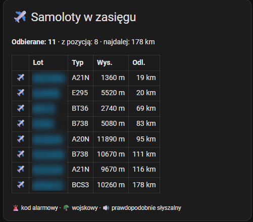

# ha-adsb-card

Karta Home Assistant pokazująca samoloty w zasięgu **własnego odbiornika ADS-B** – bez chmury, bez kluczy API, dane pobierane bezpośrednio z odbiornika w sieci lokalnej.

*English summary: a Home Assistant package + Markdown card listing aircraft received by your own ADS-B receiver. Works with readsb / tar1090 / dump1090 (`aircraft.json`, e.g. ADS-B.im, PiAware) and with the Flightradar24 Pi24 image (`fr24feed` `flights.json`). The data format is detected automatically.*



## Co pokazuje karta

- liczbę odbieranych samolotów, liczbę samolotów z pozycją i największą bieżącą odległość,
- tabelę najbliższych samolotów (domyślnie 15): znak wywoławczy z linkiem do mapy [adsb.fi](https://globe.adsb.fi), typ, wysokość w metrach, odległość w km,
- ikony: 🚨 kod alarmowy (7500 / 7600 / 7700), 🪖 samolot wojskowy, 🔊 samolot prawdopodobnie słyszalny (nisko i blisko, progi do ustawienia).

Dodatkowo powstaje czujnik `sensor.ads_b_samoloty`, którego historia pokazuje natężenie ruchu w ciągu doby.

## Obsługiwane odbiorniki

| Odbiornik / oprogramowanie | Adres danych | Typ samolotu | 🪖 wojskowe |
|---|---|---|---|
| [ADS-B.im](https://adsb.im), tar1090, readsb, ultrafeeder | `http://ADRES:8080/data/aircraft.json` | ✅ | ✅ |
| PiAware / SkyAware (dump1090-fa) | `http://ADRES/skyaware/data/aircraft.json` | zależnie od konfiguracji | zależnie od konfiguracji |
| [Pi24](https://www.flightradar24.com/build-your-own) (fr24feed) | `http://ADRES:8754/flights.json` | ❌ | ❌ |

`ADRES` to adres IP odbiornika w sieci lokalnej. Port i ścieżka mogą się różnić w zależności od instalacji – najpewniej jest otworzyć mapę odbiornika w przeglądarce i dopisać do jej adresu `data/aircraft.json`. Jeśli przeglądarka pokaże dane JSON, adres jest dobry.

Format `flights.json` z Pi24 nie zawiera typu samolotu ani informacji, czy jest wojskowy – te kolumny pozostaną puste, reszta karty działa normalnie.

## Wymagania

- Home Assistant **2024.10** lub nowszy,
- odbiornik ADS-B dostępny w tej samej sieci co Home Assistant,
- **lokalizacja domu w Home Assistant** (Ustawienia → System → Ogólne) ustawiona możliwie blisko anteny – od niej liczona jest odległość samolotów,
- system jednostek metryczny (przy imperialnym odległości będą w milach, mimo opisu „km”).

## Instalacja

### 1. Pakiet z czujnikiem

1. Włącz pakiety w `configuration.yaml` (jeśli jeszcze nie są włączone):
   ```yaml
   homeassistant:
     packages: !include_dir_named packages
   ```
2. W katalogu konfiguracji Home Assistant – tym, w którym leży `configuration.yaml` – utwórz podkatalog `packages` i skopiuj do niego plik [`packages/adsb.yaml`](packages/adsb.yaml). Zależnie od sposobu dostępu ten katalog widać jako `homeassistant/` (np. dodatki Samba share, File editor, Studio Code Server w HA OS) albo `config/` (np. instalacja w Dockerze), więc docelowa ścieżka to `homeassistant/packages/adsb.yaml` lub `config/packages/adsb.yaml`.
3. W skopiowanym pliku zmień adres w `rest_command.adsb_pobierz` → `url` na adres danych Twojego odbiornika (patrz tabela wyżej).
4. Sprawdź konfigurację (Narzędzia deweloperskie → YAML → Sprawdź konfigurację) i uruchom ponownie Home Assistant.
5. Po kilkunastu sekundach czujnik `sensor.ads_b_samoloty` powinien pokazywać liczbę samolotów.

### Masz już własny czujnik ADS-B?

Jeśli wcześniej skonfigurowałeś czujnik o nazwie „ADS-B samoloty” (np. czujnik REST w `configuration.yaml`), usuń jego konfigurację **i** samą encję w Ustawienia → Urządzenia i usługi → Encje, zanim uruchomisz ponownie HA. W przeciwnym razie nowy czujnik dostanie identyfikator z dopiskiem `_2` i karta nie znajdzie danych.

### 2. Karta

Na pulpicie wybierz **Edytuj → Dodaj kartę → Ręczna** i wklej zawartość pliku [`dashboard/adsb-card.yaml`](dashboard/adsb-card.yaml).

## Ustawienia

| Gdzie | Ustawienie | Domyślnie | Znaczenie |
|---|---|---|---|
| `packages/adsb.yaml` | `url` | – | adres danych odbiornika |
| `packages/adsb.yaml` | `seconds: "/15"` | 15 s | jak często odświeżać dane |
| `packages/adsb.yaml` | `limit` | 15 | ile najbliższych samolotów przekazać do karty |
| `dashboard/adsb-card.yaml` | `slysz_km` | 5 | 🔊 maksymalna odległość w poziomie (km) |
| `dashboard/adsb-card.yaml` | `slysz_ft` | 8500 | 🔊 maksymalna wysokość (stopy) |

Progi „słyszalności” warto dopasować do własnej okolicy: jeśli samoloty nad Twoim domem zwykle przelatują na wysokości np. 4000–8000 ft i są słyszalne, ustaw `slysz_ft` nieco powyżej górnej wartości.

## Jak to działa

Pakiet nie używa czujnika REST zapisującego całą odpowiedź odbiornika. Co 15 sekund automatyczny szablon (trigger-based template) wywołuje `rest_command`, rozpoznaje format danych, liczy odległość każdego samolotu od lokalizacji domu i zapisuje w atrybucie `dane` tylko kilkanaście najbliższych samolotów w ujednoliconej postaci. Dzięki temu baza danych Home Assistant nie rośnie od dużych atrybutów i nie trzeba wyłączać czujnika z historii.

Struktura atrybutu `dane` (do wykorzystania we własnych kartach i automatyzacjach):

```yaml
z_pozycja: 42          # samoloty z pozycją
najdalej_km: 187       # największa bieżąca odległość
lista:                 # najbliższe samoloty, posortowane po odległości
  - hex: 48c1b4        # adres ICAO
    lot: LOT3922       # znak wywoławczy, rejestracja lub adres ICAO
    typ: E195          # typ (pusty dla Pi24)
    ft: 6500           # wysokość barometryczna w stopach (0 = na ziemi)
    km: 2.4            # odległość od lokalizacji domu
    sqk: "2341"        # squawk
    mil: 0             # 1 = wojskowy (tylko readsb/tar1090 z bazą samolotów)
```

## Rozwiązywanie problemów

| Objaw | Przyczyna | Co zrobić |
|---|---|---|
| Karta: „Brak danych z odbiornika”, a odbiornik działa | Stary czujnik o tej samej nazwie zajmuje `sensor.ads_b_samoloty`, nowy dostał np. `sensor.ads_b_samoloty_2` | Ustawienia → Urządzenia i usługi → Encje, wyszukaj „ADS-B”: usuń stary czujnik, a nowemu zmień identyfikator na `sensor.ads_b_samoloty` (albo wpisz właściwy identyfikator w zmiennej `czujnik` w karcie) |
| Karta: „Brak danych z odbiornika” | Zły adres, odbiornik wyłączony lub HA nie ma do niego dostępu | Narzędzia deweloperskie → Akcje → `rest_command.adsb_pobierz` z opcją „Zwróć odpowiedź” – powinien być `status: 200`; ustaw w routerze stały adres IP odbiornika |
| Odległości nie zgadzają się z mapą odbiornika | Lokalizacja domu w HA daleko od anteny | Popraw lokalizację w Ustawienia → System → Ogólne |
| Kolumna „Typ” pusta, brak 🪖 | Pi24 albo tar1090 bez bazy samolotów | Ograniczenie źródła danych; w readsb/tar1090 włącz bazę samolotów |
| Błąd przy sprawdzaniu konfiguracji | Starsza wersja HA lub pakiety niewłączone | Zaktualizuj HA do 2024.10+; sprawdź krok 1 instalacji |

## Prywatność

Dane są pobierane wyłącznie z odbiornika w Twojej sieci lokalnej. Pakiet nie wysyła niczego na zewnątrz. Linki w tabeli prowadzą do publicznej mapy adsb.fi i otwierają się dopiero po kliknięciu.

## Licencja

[MIT](LICENSE)
